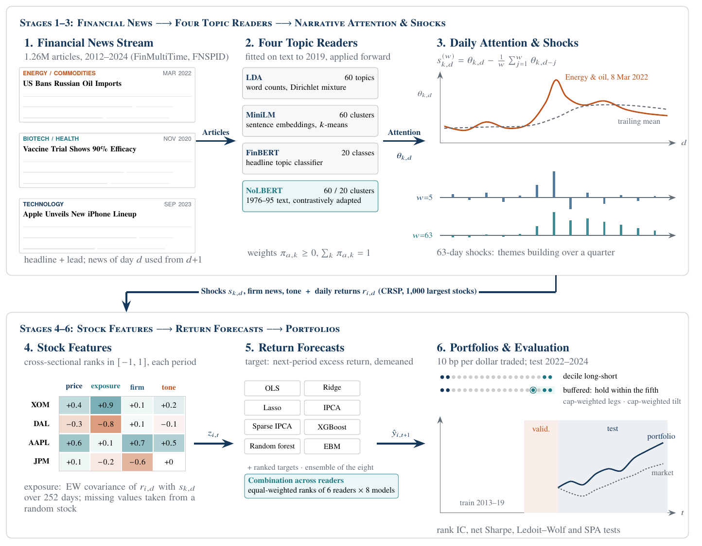
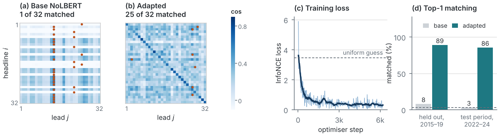
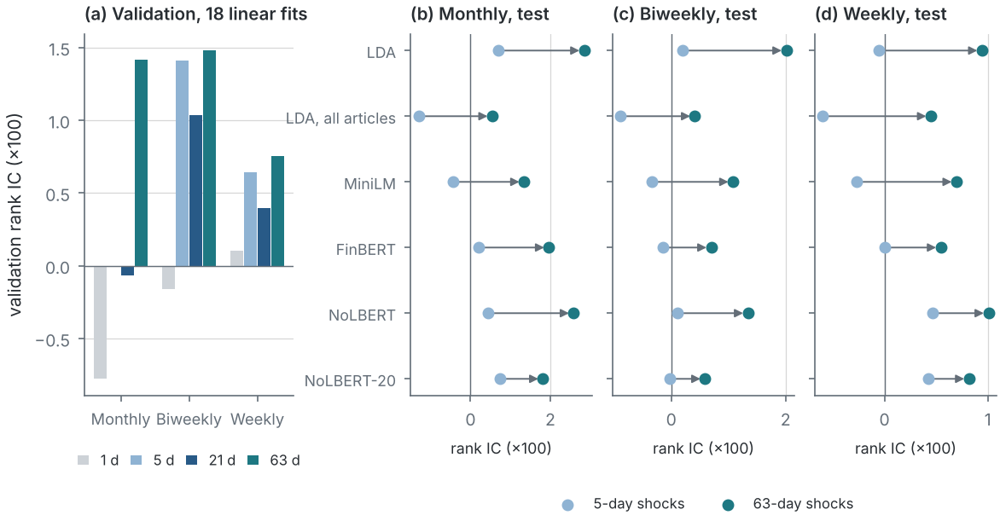
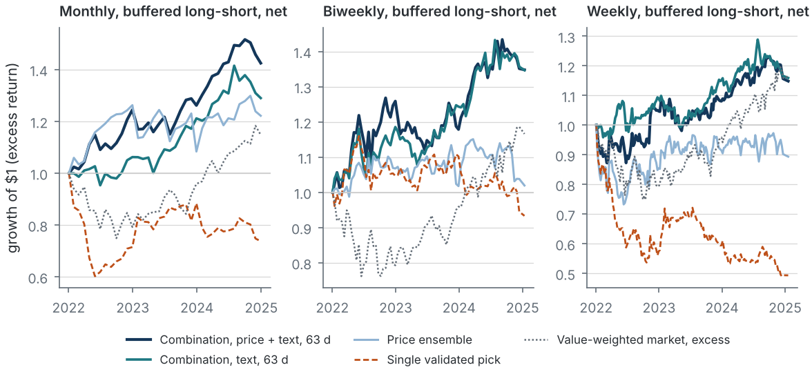

# Reading the News Without Hindsight

Code and results for *Reading the News Without Hindsight: NoLBERT Topics and the Cross-Section of Stock Returns* (Foley, Hartadi, Prakash, Takkallapalli and Vatsal, UC Berkeley, 2026).

Language models that read financial news are usually trained on text from the same years used to test them, so a backtest can reward hindsight. This repository builds news topics with [NoLBERT](https://huggingface.co/alikLab/NoLBERT), an encoder pretrained only on text published between 1976 and 1995, and compares them with LDA, MiniLM and FinBERT topics on 1.26 million Nasdaq.com articles from 2012 to 2024. Each reader's topics become daily attention, attention shocks and stock exposures to those shocks, which feed eight forecasting models and nine portfolio rules for the 1,000 largest US stocks at monthly, biweekly and weekly frequencies. Models are fitted on 2013–2019, every choice is made on 2020–2021, and 2022–2024 is held out.



## Results

All numbers are for the 2022–2024 test period and net of 10 basis points of trading costs. `FINDINGS.md` has the full set, with the caveats.

- **The single best validation experiment fails.** At every frequency it is an EBM, and its Sharpe ratios are −0.23, −0.27 and −1.08. Its pairwise terms, built mostly on imputed firm-news features, carry most of the model.
- **Attention measured over a quarter works better.** Comparing a topic's attention with its mean over the past 63 trading days instead of the past 5 raises the test rank IC of every reader at every frequency, and the window was chosen on validation by a rule set in advance.
- **NoLBERT forecasts about as well as LDA** and gives the most stable and even topics of the six readers. Contrastive fine-tuning on pairs of passages from the same article, with no labels or returns, raises its same-article matching from 8% to 89% on held-out pairs and to 86% on unseen 2022–2024 articles.
- **Combining helps.** An equal-weight combination of all readers and models with the 63-day window earns a monthly net Sharpe ratio of 1.12 (1.19 with a holding buffer). That is significant against zero before adjusting for the size of the search, but it does not beat a price-only ensemble, and no experiment survives a false-discovery correction.







## Repository

```
ftm/            the library: news, topics, features, panel, models, portfolios, evaluation
scripts/        the pipeline, numbered in the order it runs
tests/          unit tests and an end-to-end run on an artificial market
data/           inputs and intermediate files; only the fitted topic models are in git
results/        result tables, per-period series, tuning records, model explanations
paper/          scripts, inputs, figures and tables of the paper
FINDINGS.md     what we found, with the numbers
REFERENCE.md    data sources, every step and parameter, the statistics
```

## Set-up

Python 3.10 or newer.

```bash
pip install -r requirements.txt
python -m pytest tests -q          # about a minute; needs no data
```

## Data

`data/README.md` describes every folder. Three inputs are needed.

1. **Returns** (`data/crsp/`). CRSP is licensed and is not in this repository. With WRDS access, `pip install wrds` and `python scripts/00_pull_crsp.py --out data/crsp`.
2. **Articles** (`data/news/`). Rebuilt from the public FinMultiTime and FNSPID datasets with scripts 01 and 02 (a 3.6 GB download, and a 23 GB file read in pieces).
3. **Topic models** (`data/topics/<model>/`). Committed for all six readers, so steps 3 and 4 can be skipped. The adapted NoLBERT encoder (434 MB) and the article embeddings are not in git; `scripts/03c_finetune_encoder.py` rebuilds the encoder on a GPU in about 150 minutes.

## Replicate

```bash
python scripts/00_pull_crsp.py --out data/crsp
python scripts/01_download_news.py --source finmultitime
python scripts/01_download_news.py --source fnspid
python scripts/02_build_articles.py

# topic models (optional: fitted ones are committed)
python scripts/03_embed.py
python scripts/04_fit_topics.py lda                 # or --reuse lda to apply the committed topics
python scripts/04_fit_topics.py lda --all --reuse lda --name lda_all
python scripts/04_fit_topics.py embedding --embeddings paraphrase-MiniLM-L3-v2_d150 --name minilm
python scripts/03b_classify_topics.py
python scripts/04_fit_topics.py weights --weights finbert-topic_d150 --name finbert
python scripts/03c_finetune_encoder.py --grad-ckpt --out data/topics/encoders/nolbert_ft   # GPU
python scripts/03_embed.py --encoder data/topics/encoders/nolbert_ft                       # GPU
python scripts/04_fit_topics.py embedding --embeddings nolbert_ft_d150 --name nolbert
python scripts/04_fit_topics.py embedding --embeddings nolbert_ft_d150 --name nolbert20 --topics 20

# features and forecasts
python scripts/03d_sentiment.py                     # FinBERT and Loughran-McDonald tone
python scripts/05_build_panel.py --placebo lda      # monthly, biweekly and weekly panels
python scripts/05b_tune_shocks.py                   # the attention-shock window, on validation
python scripts/05_build_panel.py --shock-window 63
python scripts/05_build_panel.py --tone
python scripts/06_run_models.py                     # tune, fit and forecast
python scripts/06b_ensemble.py                      # ensembles of the eight base models
python scripts/06c_signals.py                       # single-feature signals
python scripts/06d_grand_ensemble.py                # combinations across readers

# evaluation
python scripts/07_evaluate.py
python scripts/08_report.py                         # results/tables/
python scripts/09_explain.py                        # EBM importances, shapes, ablations
python scripts/09b_ipca_factors.py
python scripts/10_audit.py
python scripts/11_missing_data_leak.py
python scripts/12_tuning_noise.py
python scripts/13_sharpe_tests.py

# paper figures and tables, from results/ (no CRSP needed)
python paper/scripts/figs_methods.py
python paper/scripts/figs_results.py
python paper/scripts/make_tables.py
```

The second block of `06_run_models.py` (the tone sets and the 63-day sets) is listed in `REFERENCE.md`, section 3. Times are for four laptop CPU cores: from the panels to the tables takes about three and a half hours, most of it in `06_run_models.py`, and the weekly EBMs need about 3 GB of memory. Scripts 03, 06 and 07 resume where they stopped. Every script prints its options with `--help`. LDA by Gibbs sampling is not bit-reproducible across machines; `--reuse lda` applies the committed topics.

The results in `results/` are committed, so the tables and the paper's figures can be rebuilt without fitting anything.

## Protocol

- Chronological split: training 2013–2019, validation 2020–2021, test 2022–2024.
- Topic models, vocabularies and the NoLBERT adaptation use text up to 2019 only. Forecasting models are tuned on validation and refitted on 2013–2021 before forecasting the test period.
- The stock universe on a date is a list that existed on that date, and news of day *d* is used from the close of day *d*+1.
- A missing value that could depend on the future (a firm without news) is replaced by another stock's values, so no model can see that it is missing.
- *t* statistics are judged against small-sample critical values, and the best of many experiments against what the best of as many would show by chance.
- The test period was examined in several runs during development, after corrections to the data that `FINDINGS.md` lists, and the combinations across readers were added after one of those runs. `FINDINGS.md`, section 13, lists this and the other limitations.

## Extending

- **A new reader.** Anything that gives each article a vector works: embed with another encoder (`03_embed.py --encoder NAME`) and run `04_fit_topics.py embedding`, or write article-topic weights and use `04_fit_topics.py weights`. `05_build_panel.py --topics <name> --skip-price` adds its feature blocks, and scripts 06 to 08 pick them up.
- **A new model.** Add a class with `name`, `grid()`, `fit`, `predict` and `refit_params` (see `ftm/models/tuning.py`) and register it in `ftm/experiments.py`.
- **A new portfolio rule.** Add a branch to `weights_for` in `ftm/portfolio/strategies.py`.
- **A new feature block.** Add a function to `makers` in `ftm/features/blocks.py` and declare the feature set in `ftm/experiments.py`.
- **Dates, universe size, costs and windows** are set in `ftm/config.py`.

## Citation

This paper builds on our earlier study:

```bibtex
@article{foley2026wordcountscontexttopic,
  title        = {From Word Counts to Context: Topic Models for Asset Pricing},
  author       = {Foley, Kevin and Hartadi, Jonathan and Prakash, Shivesh and Vatsal, Swapnil},
  year         = {2026},
  month        = {9},
  eprint       = {2609.34169},
  archiveprefix = {arXiv},
  primaryclass = {cs.CE},
  doi          = {10.2139/ssrn.7534559},
  url          = {https://arxiv.org/abs/2609.34169},
  note         = {Available at SSRN: \url{https://ssrn.com/abstract=7534559}}
}
```

Also available on SSRN: [abstract 7534559](https://ssrn.com/abstract=7534559).

## Licences and credits

Code: see `LICENSE`. News: FNSPID (Dong, Fan and Peng, 2024; CC BY-NC 4.0) and FinMultiTime (MIT); the articles belong to their publishers. Returns: CRSP via WRDS, licensed and not redistributed; only portfolio-level results are committed. Methods: Bybee, Kelly and Su (2023) for narrative exposures, Kelly, Pruitt and Su (2019) for IPCA, Bell, Kakhbod, Lettau and Nazemi (2026) for the glass-box approach, and Kakhbod and Li (2025) for NoLBERT.
